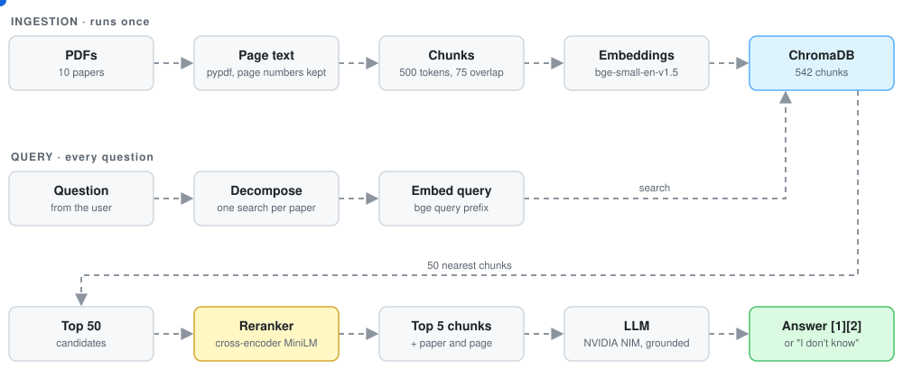
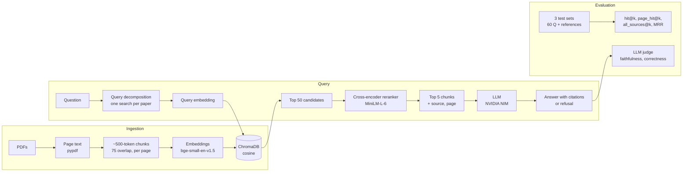

# Medical AI Paper QA: an evaluated RAG pipeline

[](https://github.com/salamon30/rag-project/actions/workflows/ci.yml)
[](https://medical-ai-papers.streamlit.app/)

> **At a glance**
>
> - **What:** ask questions about a set of PDFs and get answers that cite the exact passage and page, or "I don't know" when the documents do not say.
> - **Results:** right page in the top 5 rose from 0.45 to 0.90 with a reranker; answer correctness 5.0 / 4.8 / 4.5 (1-5) on the original, hard and held-out test sets, and 4.6 / 4.4 / 4.4 when an independent model from another vendor scores the same answers (4.8 / 4.8 / 4.4 after a later round on multi-paper questions); 98 offline unit tests in CI.
> - **Stack:** Python 3.11 · pypdf · bge-small embeddings · ChromaDB · cross-encoder reranker · NVIDIA NIM (Nemotron) · Streamlit · pytest + GitHub Actions.
> - **Try it:** [live demo](https://medical-ai-papers.streamlit.app/) (5 questions per visitor, about 30 s per answer; the example questions are instant).
> - **Run:** `pip install -r requirements.txt`, set `NVIDIA_API_KEY`, then `./scripts/download_data.sh`, `python -m ingest.run --reset` and `streamlit run app/streamlit_app.py` ([full steps](#quickstart)).

Ask questions about medical-AI research papers and get answers that cite the exact passage and page they came from. The system says *"I don't know"* instead of guessing when the retrieved text does not contain the answer.

Built end to end in Python: PDF ingestion, two-stage retrieval (vector search + cross-encoder reranker), grounded generation, a measured evaluation suite and a web UI.

![Demo: a question is typed into the Streamlit UI, the answer cites passages [1][2][4] and the sources list shows paper, page and relevance score](docs/demo.gif)

<sub>The wait for the answer (about 30 s) is cut from the recording. [Still screenshot](docs/screenshot.png).</sub>

## Highlights

- **Grounded answers with citations.** Every claim is tied to a numbered passage `[n]`, shown with file, page and relevance score.
- **Measured, not assumed.** Three test sets (60 questions, including unanswerable, false-premise, multi-paper and a held-out set never tuned on) score retrieval (hit@k, MRR) and answers (LLM-as-judge faithfulness and correctness).
- **Refuses instead of hallucinating.** When retrieval misses, the model declines rather than inventing an answer.
- **Two-stage retrieval.** A cross-encoder reranker re-scores the vector-search candidates. It eliminated every refusal in the test set.
- **Debugged with data.** Several design choices below were changed because the evaluation exposed a problem.

## Results

20 questions over 10 papers, k = 5. Both runs use the same corpus, prompts and LLM; the only difference is the reranker.

| Metric | Vector search only | + Reranker |
|---|---|---|
| Retrieval hit@1 | 0.70 | **0.80** |
| Retrieval hit@5 | 0.90 | **1.00** |
| Right page in top 5 (page_hit@5) | 0.45 | **0.90** |
| MRR@10 | 0.81 | **0.88** |
| Refusals ("I don't know") | 5 | **0** |
| Answers with citations | 100% | 100% |
| Faithfulness (1-5, LLM judge) | 5.00 | 5.00 |
| Correctness (1-5, LLM judge) | 3.95 | **5.00** |

Reports: [with reranker](eval/report.md) · [without reranker](eval/report_no_rerank.md) · [reranker comparison](eval/retrieval_comparison.md)

**What changed.** Vector search usually found the right *paper* but often not the *page* with the answer, so the model correctly refused. In the hardest case the answer passage sat at rank 28. The cross-encoder reads the question and each candidate passage together and moves the answering passage to the top. The model's answers were already faithful; the reranker gave them the right evidence.

**Reading the scores honestly.** Correctness of 5.0 means this test set no longer separates good from great, so a second, harder set was built (below). Manual spot checks agree with the judge, except one answer that omitted half of the reference and would deserve a 4.

### Hard test set

[20 more questions](eval/testset_hard.jsonl) of four kinds the first set never asked, each checked against the PDF text:

- **Unanswerable** (6): the topic is in the corpus but the fact is not, e.g. *"How much did it cost to train MedSAM?"* The system must say it does not know.
- **False premise** (4): *"Why did CheXNet use ResNet-50?"* (it uses DenseNet-121). The system must correct the question.
- **Multi-paper** (6): the answer needs two papers, e.g. comparing two models' MedQA scores.
- **Paraphrase** (4): the question avoids the paper's keywords.

| Question type | First prompt | + false-premise rule | + query decomposition (current) |
|---|---|---|---|
| Unanswerable (declined) | 5.0 (6 / 6) | 5.0 (6 / 6) | 5.0 (6 / 6) ✅ |
| False premise | 2.0 | **5.0** | 4.0 ¹ |
| Multi-paper | 3.0 | 3.7 | **5.0** ² |
| Paraphrase | 5.0 | 5.0 | 5.0 |
| **All 20** | 3.8 | 4.6 | **4.8** |

Correctness 1-5. Reports: [current](eval/report_hard.md) · [without decomposition](eval/report_hard_no_decompose.md). The original 20 questions score 5.0 in every column.

¹ One false-premise answer (h08) flipped to a refusal although it received exactly the same five passages as the run before: run-to-run variation of the LLM, not an effect of decomposition.

² Scored by the same-model judge. An independent judge later gave 3.7: two of these six answers contain a wrong number ([Second judge](#second-judge)).

**What the hard set found.**
1. **The prompt was too strict.** The model refused false-premise questions because the passages did not explain *why ResNet-50 was chosen*. One added rule ("if the passages contradict the question's assumption, correct it with citations") fixed all four without making it answer any unanswerable question.
2. **The reranker can crowd out a second paper.** For multi-paper questions it sometimes filled all five slots from one paper, and the model then correctly said it lacked the other half. A fixed cap on chunks per paper fixed that but pushed the right page out for single-paper questions (page_hit@5 0.90 → 0.70), so it stays off ([diversity_comparison.md](eval/diversity_comparison.md)).
3. **Query decomposition fixed it per question.** An LLM call splits a comparison into one search per paper, and the results are interleaved. The first prompt split 35 of 40 questions, including single-paper ones ("U-Net challenge" + "U-Net image types"), and page hits on the original set fell to 0.65. Rather than tuning the prompt further, the retriever now checks each split: it is kept only if the sub-queries' best hits come from different papers. Multi-paper retrieval (all papers in top 5) rose from 0.79 to 0.93 and multi-paper correctness from 3.7 to 5.0; the original set's answers are unchanged.

### Held-out test set

Every change above was tuned while looking at the first two sets, so their scores could be optimistic. [20 new questions](eval/testset_heldout.jsonl) were written afterwards and run once, with no changes to the code or prompts. Each answer was checked against the PDF text, with page numbers.

| Question type | Hard set (tuned on) | Held-out set |
|---|---|---|
| Single paper (10) | – | 4.8 |
| Paraphrase (3) | 5.0 | 5.0 |
| Unanswerable, declined (2) | 5.0 | 5.0 ✅ |
| False premise (2) | 4.0 | 5.0 |
| Multi-paper (3) | 5.0 | **2.3** |
| **All 20** | 4.8 | **4.5** |

Correctness 1-5. Retrieval on the held-out set: hit@5 1.00, page_hit@5 0.94, MRR@10 0.94. [Full report](eval/report_heldout.md).

**What the held-out set found.**
1. **Most of the gains generalise.** Single-paper, paraphrase, unanswerable and false-premise questions score 4.8-5.0 on questions the system was never tuned on. The false-premise prompt rule holds up.
2. **Multi-paper questions do not.** The perfect 5.0 on the hard set was partly fitted to those six questions. Each held-out failure has a different cause:
    - **A chained question (x16).** *"Which model did the GPT-4 study cite but not test, and how was it adapted?"* The second search depends on the answer to the first, and decomposition only splits side-by-side comparisons. No Med-PaLM page was retrieved, so the model declined.
    - **A chunk boundary (x14).** The CheXNet passage in the top 5 ends at "We train", one sentence before the batch size and learning rate. The overlapping next chunk has them but ranked lower, so the comparison came out half empty.
    - **A misread number (x15).** The model said MedRAG uses 4 snippets by default; the paper says 32, on a page that was not retrieved.
3. **The judge missed a wrong number.** Re-scored after its reference was corrected, x15 got 5/5 four times in a row, each time accepting "4 snippets" against a reference of 32. It is scored by hand (3/5) and marked as manual in the report.
4. **The test set had a bug too.** The x15 reference only gave RAG's training setting (5 or 10 documents). The paper's appendix also reports 15 and 50 documents at test time, which the model had correctly cited. The reference was fixed and the saved answer re-scored without regenerating it.

### Second judge

All scores above come from a judge that is the same model as the generator, which can favour its own answers. To check this, the 60 saved answers were scored again by a model from a different vendor (`minimaxai/minimax-m3.1-flash`). Nothing was regenerated: both judges saw the same question, passages, answer and reference (`python -m eval.rejudge --model ...`).

| Test set | Same-model judge | Independent judge | Same score | Within 1 point |
|---|---|---|---|---|
| Original (20) | 5.00 | 4.55 | 60% | 95% |
| Hard (20) | 4.80 | 4.35 | 75% | 90% |
| Held-out (20) | 4.50 | 4.35 | 85% | 100% |

Correctness 1-5. [Full comparison](eval/judge_comparison.md) with every disagreement and the second judge's reason.

**What the second judge found.**
1. **The same-model judge was lenient, never strict.** The independent judge scored 16 of 60 answers lower and none higher. Most gaps are one point for a correct answer that leaves out a detail of the reference.
2. **It caught two wrong answers that had scored 5/5.** Asked how much higher Medprompt's MedQA accuracy is than Flan-PaLM's, the system answered "13.5"; the reference is 22.6 points (h13, now 1/5). Asked which training set is larger, it reached the right conclusion from an invented figure of about 1,470 CheXNet images instead of 112,120 (h12, now 3/5). Both are multi-paper questions.
3. **So the hard set's multi-paper score was too high.** With the independent judge it is 3.7, not 5.0, which is in line with the 2.3 on the held-out set: retrieval finds both papers after query decomposition, but combining their numbers still goes wrong.
4. **The held-out set moved least** (4.50 to 4.35), and its hand-checked multi-paper scores did not change.

### Multi-paper round

Multi-paper questions were the weak spot in both earlier sets, so one more round targeted them. To keep the measurement clean, [10 new multi-paper questions](eval/testset_multi.jsonl) were written first and the unchanged system was run on them. Then four changes were made, developed only on the multi-paper questions of the older sets:

- **More passages for a split question.** When a question is split into one search per paper, the generator reads 8 passages instead of 5, so each paper is not limited to two or three.
- **The text after each hit.** Every passage is extended with the first 600 characters of the chunk that follows it in the paper. This fixed the comparison that had been cut off one sentence before the batch size (x14).
- **A rule for figures.** State each figure with its citation, then compute; never derive a figure the passages do not state. This fixed the two wrong numbers the independent judge had found (h12, h13).
- **A follow-up search after a refusal**, for chained questions. Measured and left off (below).

Correctness 1-5 from the independent judge, same-model judge in brackets:

| Test set | Before | After |
|---|---|---|
| New multi-paper questions (10), never tuned on | 3.4 (3.8) | **3.6** (4.0) |
| Original (20) | 4.55 (5.00) | 4.75 (4.95) |
| Hard (20) | 4.35 (4.80) | 4.75 (5.00) |
| Held-out (20) | 4.35 (4.50) | 4.35 (5.00) |

Reports: new set [before](eval/report_multi_before.md) · [after](eval/report_multi.md) · [judge comparison after](eval/judge_comparison_r2.md) · [before](eval/judge_multi_before.md).

**What this round found.**
1. **The gain on unseen questions is small: 3.4 to 3.6.** On the older sets the same changes look much better (multi-paper 3.7 to 4.7 on the hard set, 2.3 to 3.7 on the held-out set), but those are the questions the changes were developed on. The new set is the honest number.
2. **The remaining failures are retrieval, not reading.** In the new set the page that states the figure is missing in most wrong answers: the U-Net training page (y03), the Med-PaLM abstract with 67.6% (y07, answered 19.3 from a table that lists 67.2%), the page that defines MultiMedQA (y06). The sub-query finds the right paper but not the right page. More passages did not fix that; a better per-paper search would.
3. **The follow-up search did not earn its cost.** It ran 8 times in 70 questions: 7 times on unanswerable questions, where the refusal was correctly kept at the price of two extra LLM calls, and once on a chained question (y04) that it did not solve. On a development run it also replaced an honest "this figure is missing" with wrong numbers. It stays in the code behind `FOLLOWUP=1`.
4. **Single-paper questions on the held-out set went down** (4.6 to 4.2 with the independent judge; four answers lost one or two points, and in one of them, x09, the judge flagged figures that do not match the paper). This may be a cost of the longer passages or run-to-run variation; the two were not separated here. No other question type got worse.
5. **Some answers are still a bare number** ("19.3"), despite a prompt rule that asks for a full sentence with citations.

## Architecture



<details>
<summary>Text version of the diagram (with evaluation)</summary>



</details>

| Component | Choice |
|---|---|
| PDF parsing | `pypdf`, page by page so citations keep exact page numbers |
| Chunking | ~500 tokens, 75 overlap; boundaries from the embedding model's tokenizer, text sliced from the original page |
| Embeddings | `BAAI/bge-small-en-v1.5` (384-dim, 512-token window, runs locally) |
| Vector store | ChromaDB, persistent, cosine distance, deterministic chunk IDs for idempotent re-ingestion |
| Query decomposition | One short LLM call splits multi-paper questions into one search per paper; a split is kept only if the searches reach different papers |
| Reranker | `cross-encoder/ms-marco-MiniLM-L-6-v2` re-scores the top 50 vector hits; chosen over `bge-reranker-base` for equal hit rates at ~6x lower latency |
| LLM | `nvidia/nemotron-3.5-lightning-30b-a3b` via NVIDIA NIM's OpenAI-compatible API |
| UI | Streamlit, with shareable `?q=` question links |

## Engineering decisions and lessons

These came from measuring, not from the first draft.

1. **Embedding window vs. chunk size.** The first embedding model, `all-MiniLM-L6-v2`, reads only 256 tokens, so half of every 500-token chunk was invisible to search. Switching to `bge-small-en-v1.5` with a 512-token window fixed this without shrinking chunks.
2. **Reasoning on for the generator.** With the model's hidden reasoning turned off, answers dropped citations entirely and misread passages with confidence. Reasoning stays on, with a no-reasoning fallback if the token budget runs out.
3. **Reasoning off for the judge.** With reasoning on, the judge spent its whole budget thinking and returned no score for 7 of 20 questions. Scoring is a short rubric task, so the judge runs without it.
4. **Do not trust the judge blindly.** The judge rated an *"I don't know"* answer as fully correct. Since every test question is answerable, refusals are now scored correctness 1 by rule. A refusal detector that was too broad also flagged a correct answer containing "does not include zero"; it now requires a refusal phrase and no citations.
5. **Keep the original text, not the tokenizer's version.** Chunks were first built by decoding token windows. Because the embedding tokenizer is uncased, stored text came out lowercased with `##` word pieces and `[UNK]`, and that is what the LLM and citations saw. Chunks are now sliced from the original page using the tokenizer's character offsets.
6. **Rerankers: measure the trade-off.** A retrieval-only evaluation mode (no LLM calls, under a minute) compared two cross-encoders. Both doubled page-level hits; the smaller one was ~6x faster, so it is the default.
7. **Errors must not lose the run.** A single failed API call used to abort the whole evaluation. Each question is now isolated and failures are reported as unscored.
8. **Let the LLM propose and the code check.** Prompt tuning alone swung query decomposition between splitting everything and splitting nothing. An eager prompt plus a cheap retrieval check (do the sub-queries reach different papers?) gave both recall and precision.
9. **Check the input before blaming the change.** Two answers changed after decomposition was switched on, but both received identical passages in both runs. One was LLM variation; the other was a correct decline that the scoring rule did not recognise. The rule was fixed and saved answers are re-scored without new LLM calls (`--rescore`).

## Quickstart

Requires Python 3.11 and an [NVIDIA NIM API key](https://build.nvidia.com/).

```bash
git clone https://github.com/salamon30/rag-project.git && cd rag-project
python3.11 -m venv .venv && source .venv/bin/activate
pip install -r requirements.txt
cp .env.example .env               # then set NVIDIA_API_KEY

./scripts/download_data.sh         # 10 open-access arXiv papers into data/
python -m ingest.run --reset       # build the vector store
```

Then use any of the three entry points:

```bash
streamlit run app/streamlit_app.py                         # web UI at localhost:8501
python -m rag.ask "What is the MIRAGE benchmark?"          # command line
python -m eval.run_eval                                    # full evaluation (~15 min)
python -m eval.run_eval --retrieval-only cross-encoder/ms-marco-MiniLM-L-6-v2   # compare retrievers, no LLM
```

### With Docker

```bash
docker build -t rag-demo .                         # downloads the papers and builds the index into the image
docker run -p 7860:7860 --env-file .env rag-demo   # web UI at localhost:7860
```

The image uses CPU-only PyTorch (about 3.3 GB in total) and needs only `NVIDIA_API_KEY` at run time.

### Hosted demo

The [live demo](https://medical-ai-papers.streamlit.app/) runs on Streamlit Community Cloud from `main`, so every push redeploys it; `app/requirements.txt` installs CPU-only PyTorch there.

Streamlit puts a free app to sleep when nobody visits it. A scheduled GitHub Actions job ([keep-demo-awake.yml](.github/workflows/keep-demo-awake.yml)) opens the demo in a headless browser every 8 hours and presses the wake-up button if needed.


Set `DEMO_DAILY_LIMIT` as an environment variable or Streamlit secret (and optionally `DEMO_SESSION_LIMIT`, default 5) to cap new questions per day and per visitor, so a public deployment cannot use up the API key. Repeated questions are served from a shared cache and the example questions never count. A hosted copy without `data/` and `chroma_db/` downloads the papers and builds the index on first start (about 2 minutes). Local runs are unlimited.

### Tests

```bash
pip install -r requirements-dev.txt
pytest -q          # 98 unit tests, about 5 s
ruff check .
```

The tests use small fakes for the tokenizer, embedder, vector store, reranker and LLM client, so they need no API key, no model downloads and no PDFs. They cover chunk boundaries and overlap, the reranker reordering, the thinking fallback in the generator, judge output parsing, the refusal detector and the retrieval metrics. Several are regression tests for bugs found during development. GitHub Actions runs lint and tests on every push and pull request.

## Project structure

```
ingest/    load PDFs, chunk, embed, store (Stage A)
rag/       two-stage retriever, generator with citation rules, pipeline, CLI (Stage B)
eval/      test set, metrics, LLM judge, report.md + results.csv (Stage C)
app/       Streamlit UI and demo usage limits
scripts/   corpus download
tests/     offline unit tests (pytest)
```

## Corpus

Ten open-access arXiv papers on medical AI and RAG: the original RAG paper, a RAG survey, MedRAG, Med-PaLM and Med-PaLM 2, GPT-4 on medical exams, Medprompt, MedSAM, CheXNet and U-Net. The PDFs are not redistributed here; `scripts/download_data.sh` fetches them from arXiv.

## Limitations and next steps

- **Same model as generator and judge in the main reports.** It was lenient: an independent judge scored about 0.15 to 0.45 points lower per set and caught two wrong answers (see [Second judge](#second-judge)). The per-type tables above still show the same-model scores.
- **Multi-paper questions are the weak spot.** They score 3.6 on 10 unseen questions after the [multi-paper round](#multi-paper-round) (2.3 on the held-out set before it). The open problem is finding the right page inside each paper; chained questions, where one search depends on another's answer, are also still unsolved (the follow-up search did not fix them).
- **Small held-out set.** 20 questions, 3 of them multi-paper, so one answer moves a type's average a lot.
- **The judge is lenient on partial answers and can miss wrong numbers.** It gave 5/5 to a multi-paper answer that covered only one of the two papers (h15), and 5/5 to an answer with a wrong snippet count (x15). Answer scores are spot-checked by hand, and refusals are scored by rule rather than by the judge.
- **Run-to-run variation.** LLM answers and decomposition can differ between identical runs; single-question changes should be checked against the retrieved passages before they are attributed to a code change.
- **Decomposition cost.** One extra LLM call and up to three searches per question (about 1.5 s more on a laptop). `DECOMPOSE=0` turns it off.
- **Latency.** Reranking adds about 0.6 s per question on a laptop CPU. Hybrid BM25 + dense search could reduce the candidate set further.
- **Per-page chunking** keeps citations exact but splits passages that cross page boundaries.

## License

MIT, see [LICENSE](LICENSE).
